# MarkdownUI

[](https://github.com/ripulio/swift-markdown-ui/actions/workflows/ci.yml)
[](https://swiftpackageindex.com/ripulio/swift-markdown-ui)
[](https://swiftpackageindex.com/ripulio/swift-markdown-ui)
[](LICENSE)

**Native, single-pass GitHub Flavored Markdown for SwiftUI — built for 120 Hz scrolling and live AI/LLM streaming.**

`ripulio/swift-markdown-ui` (**MarkdownUI 2.5**, maintained by [Ripul](https://github.com/ripulio)) is a **100% API-compatible drop-in upgrade** to `gonzalezreal/swift-markdown-ui` (`2.4.1`, now in maintenance mode). Keep `import MarkdownUI` and every existing `Theme` or view modifier unchanged: swapping the package URL upgrades `.basic`, `.gitHub`, `.docC`, and the new `.chat` preset to a single-pass layout engine that is **4×–8× faster than upstream** — and faster than plain `SwiftUI.Text` on rich replies, bullet lists, and code blocks.


---

## Highlights in 2.5

- **Zero-jitter single-pass layout (`Δ 0.0pt`):** Block margins resolve directly from the parsed syntax tree on pass 1 instead of waiting on `PreferenceKey` -> `@State` -> second-pass re-layout cycles. `List` and `ScrollView` containers never jump or stutter during fast scrolling.
- **Built for 60–120 Hz AI streaming:** Blocks and measured state are keyed by structural tree position (`markdownBlockPath`) rather than full string value, so token-by-token streaming updates only the active trailing block without resetting scroll offsets or code-block controls.
- **Direct `SwiftUI.Text` inline runs:** Plain, **bold**, and *italic* spans build direct `Text(verbatim:)` segments with pre-resolved `Font` caches instead of bridging per-run `Foundation.AttributedString` dictionaries, fixing upstream long-paragraph hangs ([#312](https://github.com/gonzalezreal/swift-markdown-ui/issues/312)) and stripped spaces after links/bold spans ([#402](https://github.com/gonzalezreal/swift-markdown-ui/issues/402)).
- **New built-in `.markdownTheme(.chat)` preset:** Tuned out of the box for AI assistants and messaging apps — proportioned chat headings, rounded callout quotes, language-header code cards, compact `BulletedListLayout`, and viewport-aware horizontal-scrolling GFM tables.
- **Zero-config speedup on `.basic`, `.gitHub`, and `.docC`:** All built-in themes automatically run on the single-pass fast path with **100% pixel-for-pixel parity** against upstream `2.4.1` — and automatically fall back if you attach a custom `.markdownBlockStyle(...)` closure.

---

## Benchmarks (iPhone 15 Pro Max)

Cold SwiftUI host sizing + layout time at `400pt` width (`thermal = nominal`, median of 5 rounds, Release build on iPhone 15 Pro Max):

| Workload (`400pt` width) | `MarkdownUI 2.5` | `MarkdownUI 2.5` (Selectable) | Plain `SwiftUI.Text` | Pass-1 Height Jump |
| :--- | ---: | ---: | ---: | ---: |
| **Rich AI Reply** (headings, prose, list, code, table) | **4.6 ms** | **5.4 ms** | 7.2 ms | **`0.0 pt`** |
| **16-Item Bullet List** (inline code, bold, links) | **3.5 ms** | **4.1 ms** | 4.6 ms | **`0.0 pt`** |
| **Fenced Code Block** (Swift snippet) | **2.4 ms** | **2.5 ms** | 10.6 ms | **`0.0 pt`** |
| **15×3 GFM Table** (adaptive columns + striped rows) | **3.0 ms** | **3.5 ms** | 1.6 ms *(unformatted)* | **`0.0 pt`** |
| **Multi-Paragraph Prose** (8 paragraphs) | **2.0 ms** | **2.0 ms** | 1.8 ms | **`0.0 pt`** |
| **Callout Blockquote** | **1.0 ms** | **1.3 ms** | 1.5 ms | **`0.0 pt`** |
| **Short Chat Bubble** | **0.5 ms** | **0.6 ms** | 0.2 ms | **`0.0 pt`** |

```mermaid
xychart-beta
    title "Cold Layout Time on iPhone 15 Pro Max (ms — lower is faster)"
    x-axis ["Rich Reply", "Bullet List", "Code Block", "8 Paragraphs", "Callout"]
    y-axis "Layout Time (ms)" 0 --> 12
    bar [4.6, 3.5, 2.4, 2.0, 1.0]
    bar [7.2, 4.6, 10.6, 1.8, 1.5]
```


> **Series 1 (left bar):** `MarkdownUI 2.5` (full GFM styling, lists, code cards & tables) · **Series 2 (right bar):** unstyled `SwiftUI.Text` rendering raw Markdown source.

Reproduce these numbers on your own iPhone or Mac in 30 seconds with [`Examples/BenchmarkApp`](Examples/BenchmarkApp/).

---

## Why Switch from Upstream `2.4.1`?

| Capability | `gonzalezreal/swift-markdown-ui` `2.4.1` | `ripulio/swift-markdown-ui` `2.5.0` |
| :--- | :--- | :--- |
| **Status** | Maintenance mode | Actively maintained & benchmarked in production |
| **Public API (`import MarkdownUI`)** | Original API | **100% drop-in compatible** (`from: "2.5.0"`) |
| **Block margin layout** | 2-pass `PreferenceKey` + `@State` updates (causes `List` scroll jumps) | **Single-pass tree-resolved margins (`0` height jumps)** |
| **LLM token streaming** | Keyed by full block value; resets child `@State` every token | **Keyed by structural `markdownBlockPath`** |
| **Bulleted lists** | Per-item `Label` + width `PreferenceKey` | **`BulletedListLayout` + cached cap-center probe** |
| **GFM tables** | Fixed `Grid` + per-cell `GeometryReader` bounds preferences | **Viewport-aware `AdaptiveTableLayout` + shape-batched borders** |
| **Long / newline-heavy paragraphs** | Recursive `Text + Text` tree hangs UI ([#312](https://github.com/gonzalezreal/swift-markdown-ui/issues/312)) | **Balanced `Text(verbatim:)` runs + bounded line-break chunks** |
| **Space after bold / links** | Dropped after leading inline spans ([#402](https://github.com/gonzalezreal/swift-markdown-ui/issues/402)) | **Fixed + regression-tested** |
| **Images mixed with text** | Provider ignored outside image-only paragraphs ([#420](https://github.com/gonzalezreal/swift-markdown-ui/issues/420)) | **Inline `ImageFlow` + `markdownInlineImageFlow()`** |
| **Continuous text selection** | Partial / broken across blocks | **`textSelection(.enabled)` + `MarkdownContent.renderAttributedString`** |

---

## Installation & 1-Line Migration

### Swift Package Manager (`Package.swift`)

Replace the upstream URL (or add `swift-markdown-ui` fresh) in your `Package.swift`:

```swift
dependencies: [
  .package(url: "https://github.com/ripulio/swift-markdown-ui", from: "2.5.0")
]
```

Then link `"MarkdownUI"` to your target — **no source changes required**:

```swift
.target(
  name: "YourApp",
  dependencies: [
    .product(name: "MarkdownUI", package: "swift-markdown-ui")
  ]
)
```

### Xcode

1. Open **File -> Add Package Dependencies…**
2. Paste `https://github.com/ripulio/swift-markdown-ui`
3. Select **Up to Next Major Version** from **`2.5.0`** and add **MarkdownUI** to your target.

### Minimum Platform Requirements

- **macOS** 12.0+ · **iOS** 15.0+ · **tvOS** 15.0+ · **watchOS** 8.0+
- *(GFM tables, `BulletedListLayout`, and multi-image `ImageFlow` activate automatically on macOS 13.0+ / iOS 16.0+ / tvOS 16.0+ / watchOS 9.0+.)*

---

## Quick Start

### AI / Chat Interfaces (`Theme.chat`)

```swift
import MarkdownUI
import SwiftUI

struct MessageBubble: View {
  let markdown: String

  var body: some View {
    Markdown(markdown)
      .markdownTheme(.chat)
      .textSelection(.enabled)
  }
}
```

### Pre-Parsing on a Background Actor

Parse Markdown strings off the main thread with `MarkdownContent` (which is `Equatable` and `Sendable`-friendly in model structs) so SwiftUI views do zero parsing during scroll:

```swift
// In your streaming reducer or background pipeline:
let content = MarkdownContent(rawMarkdownChunk)

// In your SwiftUI row:
Markdown(message.content)
  .markdownTheme(.chat)
```

### Expressive Swift DSL (`MarkdownContentBuilder`)

```swift
Markdown {
  Heading(.level2) {
    "Try MarkdownUI 2.5"
  }
  Paragraph {
    Strong("MarkdownUI")
    " renders GitHub Flavored Markdown natively in SwiftUI — "
    InlineLink("explore the GFM spec", destination: URL(string: "https://github.github.com/gfm/")!)
    "."
  }
}
```


---

## Styling & Built-In Themes

Every built-in theme runs on the single-pass layout fast path out of the box:

- **`.chat`** — Proportioned headings, callout bars, language-labelled code cards, and horizontal-scrolling adaptive GFM tables for chat & AI interfaces.
- **`.gitHub`** — Faithful GitHub README & issue styling in Light and Dark Mode.
- **`.docC`** — Apple DocC documentation typography, aside callouts, and code blocks.
- **`.basic`** — Clean default typography inheriting surrounding SwiftUI font metrics.

```swift
Markdown(readmeSource)
  .markdownTheme(.gitHub)
```


### Overriding Text & Block Styles

Customize individual inline or block styles without building a full theme from scratch:

```swift
Markdown("Use `git status` to inspect modified files.")
  .markdownTextStyle(\.code) {
    FontFamilyVariant(.monospaced)
    FontSize(.em(0.85))
    ForegroundColor(.purple)
    BackgroundColor(.purple.opacity(0.2))
  }
```


```swift
Markdown {
  """
  > Outside of a dog, a book is a person's best friend.
  > Inside of a dog it's too dark to read.
  """
}
.markdownBlockStyle(\.blockquote) { configuration in
  configuration.label
    .padding()
    .overlay(alignment: .leading) {
      Rectangle().fill(Color.teal).frame(width: 4)
    }
    .background(Color.teal.opacity(0.15))
}
```


---

## Advanced Capabilities

- **Adaptive GFM Tables (`markdownTableLayout(.adaptive(...))`):** Keeps narrow columns compact, wraps prose columns within readable bounds, and scrolls wide tables horizontally without clipping (`Theme.chat` enables this automatically).
- **Inline Image Flow (`markdownInlineImageFlow()`):** Flows linked and styled images alongside text in paragraphs, headings, and table cells while preserving accessibility alt labels.
- **Continuous Native Selection (`MarkdownContent.renderAttributedString`):** Renders full-document `AttributedString` output preserving inline presentation intents, links, lists, and tab-separated tables for native `UITextView` / `NSTextView` selection overlays.
- **Custom Syntax Highlighting (`CodeSyntaxHighlighter`):** Plug in Splash, Highlightr, or Tree-sitter via `.markdownCodeSyntaxHighlighter(...)`; fenced code blocks receive both the language identifier and structural `blockPath`.

---

## Sample Apps & Benchmarks

| App | Path | Purpose |
| :--- | :--- | :--- |
| **MarkdownBenchmark** | [`Examples/BenchmarkApp`](Examples/BenchmarkApp/) | Run cold millisecond layout benchmarks, check `Δ 0.0pt` pass-1 convergence, and test 120 Hz streaming on your own iPhone or Mac (`cd Examples/BenchmarkApp && xcodegen && open MarkdownBenchmark.xcodeproj`). |
| **Demo** | [`Examples/Demo`](Examples/Demo/) | Full showcase of themes, custom block/inline styles, image providers, Dingus, and GitHub README rendering. |
| **RegressionLab** | [`Examples/RegressionLab`](Examples/RegressionLab/) | Automated UI regression harness covering 1,200-link paragraphs, 7-level nested lists, Dynamic Type, and inline image flow. |


---

## Documentation & Architecture

- **API Documentation (DocC):** Hosted on [Swift Package Index](https://swiftpackageindex.com/ripulio/swift-markdown-ui/documentation/markdownui) (or build locally in Xcode via **Product -> Build Documentation**).
- **Performance Architecture & Invariants:** See [`RIPUL.md`](RIPUL.md) for a pass-by-pass breakdown of Passes 1–7, layout cache invariants, and verification details.

## Credits & License

Originally created by [Guille Gonzalez](https://github.com/gonzalezreal) (`gonzalezreal/swift-markdown-ui`, through `2.4.1`). Performance architecture, streaming stability, adaptive tables, and ongoing maintenance by [Ripul](https://github.com/ripulio).

Released under the [MIT License](LICENSE).
