# MarkdownUI

[](https://github.com/ripulio/swift-markdown-ui/actions/workflows/ci.yml)
[](https://swiftpackageindex.com/ripulio/swift-markdown-ui)
[](https://swiftpackageindex.com/ripulio/swift-markdown-ui)
[](LICENSE)
[](https://ripul.io)

**Single-pass native GitHub Flavored Markdown for SwiftUI — built for 120 Hz scrolling and live AI/LLM streaming.**

`ripulio/swift-markdown-ui` (**MarkdownUI 2.6**, maintained by **[Ripul](https://ripul.io)**) is the actively maintained, **100% source-compatible continuation** of [`gonzalezreal/swift-markdown-ui`](https://github.com/gonzalezreal/swift-markdown-ui) (`2.4.1`, now in maintenance mode as new upstream work moved to Textual for newer OS targets).

Keep `import MarkdownUI`, keep your **iOS 15+ / macOS 12+** deployment target, and keep every existing `Theme` or view modifier unchanged: swapping one package URL upgrades `.basic`, `.gitHub`, `.docC`, and `.chat` to a single-pass layout engine with **`O(1)` streaming block memoization** that eliminates `PreferenceKey` scroll jumps and runs **up to 10× faster than upstream `2.4.1`**—battle-tested daily in production inside [Ripul](https://ripul.io) and [`ripul-ios-sdk`](https://github.com/ripulio/ripul-ios-sdk).

<p align="center">
  
  
</p>

---

## Highlights in 2.6

- **Zero-jitter single-pass layout across every block type (`Δ 0.0 pt`):** Paragraphs, headings, bulleted lists, **multi-level nested lists**, **numbered lists**, **task lists**, and **built-in `.automatic` & `.adaptive` GFM tables** resolve in a single pass with zero `PreferenceKey` → `@State` re-layout jumps.
- **`O(1)` 60–120 Hz AI streaming (`2.6.0`):** Per-block `Equatable` memoization, prefix-stable `StaticViewBatch` buckets, and retained stateless prefix sizes keep completed blocks untouched as tokens arrive—cutting 95th-percentile streaming frame times by **3.5×** (`12.5 ms → 3.5 ms` on a 5.9 KB mixed reply).
- **Direct `SwiftUI.Text` inline runs (now including `Theme.gitHub` + strikethrough/underline):** Plain, **bold**, *italic*, ~~strikethrough~~, and underlined spans render via direct `Text(verbatim:)` segments with pre-resolved `Font` caches, fixing upstream newline hangs ([#312](https://github.com/gonzalezreal/swift-markdown-ui/issues/312)) and dropped spaces after links/bold spans ([#402](https://github.com/gonzalezreal/swift-markdown-ui/issues/402)).
- **Built-in `.markdownTheme(.chat)` preset:** Tuned out of the box for AI assistants and messaging apps—proportioned headings, rounded callout quotes, language-header code cards, compact single-pass lists, and viewport-aware horizontal-scrolling GFM tables.
- **Zero-config speedup on `.basic`, `.gitHub`, and `.docC`:** All built-in themes automatically run on single-pass list, table, and prose layouts with **100% pixel and height parity** against upstream `2.4.1`, falling back automatically if you attach a custom `.markdownBlockStyle(...)` closure.
- **App Store safe (`2.6.1`) & Swift 6 ready:** Eliminates upstream `2.4.1`'s `dlopen`/`dlsym` lookup of private `cmark` symbols that triggers automated App Store non-public API rejections ([#448](https://github.com/gonzalezreal/swift-markdown-ui/pull/448)), conforms `MarkdownContent` and `Theme` to `Sendable` ([#351](https://github.com/gonzalezreal/swift-markdown-ui/pull/351)), parses ~23% faster via integer-enum dispatch, and avoids iOS `.textSelection` link occlusion.

---

## Benchmarks (iPhone 15 Pro Max)

Cold attached-host sizing & settled layout time at `400pt` width on **iPhone 15 Pro Max** (median of 5 rounds, child `UIHostingController` attached to a real window, measuring total time until height settles):

| Workload (`400pt` width) | Upstream `2.4.1` *(Settled)* | `MarkdownUI 2.5` | `MarkdownUI 2.5` *(Selectable)* | Plain `SwiftUI.Text` | Speedup vs `2.4.1` | Pass-1 Jump (`2.5`) |
| :--- | ---: | ---: | ---: | ---: | ---: | ---: |
| **Rich AI Reply** *(headings, prose, list, code, table)* | 28.9 ms | **4.6 ms** | **5.4 ms** | 7.2 ms | **6.3×** | **`0.0 pt`** |
| **16-Item Bullet List** *(inline code, bold, links)* | 22.8 ms | **3.5 ms** | **4.1 ms** | 4.6 ms | **6.5×** | **`0.0 pt`** |
| **15×3 GFM Table** *(adaptive columns + stripes)* | 30.1 ms | **3.0 ms** | **3.5 ms** | 1.6 ms *(raw)* | **10.0×** | **`0.0 pt`** |
| **Fenced Code Block** *(Swift snippet)* | 8.1 ms | **2.4 ms** | **2.5 ms** | 10.6 ms | **3.4×** | **`0.0 pt`** |
| **Multi-Paragraph Prose** *(8 paragraphs)* | 6.3 ms | **2.0 ms** | **2.0 ms** | 1.8 ms | **3.1×** | **`0.0 pt`** |
| **Callout Blockquote** | 3.8 ms | **1.0 ms** | **1.3 ms** | 1.5 ms | **3.8×** | **`0.0 pt`** |
| **Short Chat Bubble** | — | **0.5 ms** | **0.6 ms** | 0.2 ms | — | **`0.0 pt`** |

```mermaid
xychart-beta
    title "Settled Layout Time on iPhone 15 Pro Max (ms — lower is faster)"
    x-axis ["Rich Reply", "Bullet List", "15x3 Table", "Code Block", "8 Paragraphs", "Callout"]
    y-axis "Settled Layout Time (ms)" 0 --> 32
    bar [28.9, 22.8, 30.1, 8.1, 6.3, 3.8]
    bar [4.6, 3.5, 3.0, 2.4, 2.0, 1.0]
```


> **Series 1 (left bar):** Upstream `MarkdownUI 2.4.1` settled time (pass 1 + `PreferenceKey` settling re-layout) · **Series 2 (right bar):** `MarkdownUI 2.5` single-pass layout.

**Methodology & Reproducibility:** Upstream `2.4.1` settled timings include both pass 1 and the asynchronous `PreferenceKey` settling pass paid by real scrolling lists (`thermal = fair`, iPhone 15 Pro Max); `MarkdownUI 2.5` and plain `SwiftUI.Text` (unstyled raw Markdown string) were measured on the same device (`thermal = nominal`). Run your own attached-host comparison against closure-based `Legacy 2.4.1`, `.chat`, `.basic`, `.gitHub`, and plain `Text` in 30 seconds with [`Examples/BenchmarkApp`](Examples/BenchmarkApp/).

### Additional Gains in `2.6.0` (macOS Release, `400pt`, `2.5.1` → `2.6.0`)

Measured on Apple Silicon macOS (Release build, attached `NSHostingView` at `400pt`, median of 5 rounds; 80-step streaming on `Theme.chat`):

| Workload (`400pt` width) | `2.5.1` | `2.6.0` | Speedup |
| :--- | ---: | ---: | ---: |
| **Numbered List (16 items)** *(`.chat` / `.basic`)* | 23.7 ms / 22.6 ms | **7.1 ms / 7.0 ms** | **3.3×** |
| **Nested Bullets (4×4)** *(`.chat` / `.basic`)* | 13.1 ms / 13.3 ms | **5.3 ms / 5.1 ms** | **2.5×–2.6×** |
| **Task List (12 items)** *(`.chat` / `.gitHub`)* | 9.9 ms / 12.2 ms | **5.0 ms / 5.6 ms** | **2.0×–2.2×** |
| **Wrapping 15×4 Table** *(`.gitHub` / `.basic`)* | 27.8 ms / 26.5 ms | **14.1 ms / 11.9 ms** | **2.0×–2.2×** |
| **Static `.adaptive(...)` 15×4 Table** | 24.2 ms | **13.4 ms** | **1.8×** |
| **Prose Plain/Bold (8p)** *(`.gitHub`)* | 7.9 ms | **3.8 ms** | **2.1×** |
| **Long Mixed Reply (5.9 KB)** *(`.chat` / `.gitHub` / `.basic`)* | 48.4 / 74.9 / 62.7 ms | **25.3 / 32.6 / 23.0 ms** | **1.9×–2.7×** |
| **80-Step Streaming — Mixed Reply (5.9 KB)** *(total / p95)* | 402.5 ms / 12.5 ms | **202.5 ms / 3.5 ms** | **2.0× total · 3.5× p95** |
| **80-Step Streaming — 16 Code/Link Paragraphs** *(total / p95)* | 188.3 ms / 4.6 ms | **61.7 ms / 1.3 ms** | **3.1× total · 3.6× p95** |
| **`MarkdownContent` Parse (5.9 KB)** | 0.186 ms | **0.142 ms** | **1.3×** |

---

## Why Switch from Upstream `2.4.1`?

| Capability | `gonzalezreal/swift-markdown-ui` `2.4.1` | `ripulio/swift-markdown-ui` `2.6.x` |
| :--- | :--- | :--- |
| **Maintenance status** | Maintenance mode (new work in Textual) | **Actively maintained & used in production** |
| **Platform floor** | iOS 15+ / macOS 12+ | **iOS 15+ / macOS 12+** *(drop-in compatible)* |
| **Public API (`import MarkdownUI`)** | Original 2.x API | **100% source-compatible** (`from: "2.6.1"`) |
| **App Store binary scan (`#448`)** | `dlopen`/`dlsym` private `cmark` literals flagged & blocked | **Public-API bootstrap (`0` flagged strings or `dlsym`)** |
| **Block margin layout** | 2-pass `PreferenceKey` + `@State` *(causes `List` jumps)* | **Single-pass tree-resolved margins (`0.0 pt` jump)** |
| **LLM token streaming** | Keyed by full block value; resets child state | **Positional identity + `O(1)` per-block memoization** |
| **Lists (bullet, nested, numbered, task)** | Per-item `Label` + width `PreferenceKey` | **Single-pass `BulletedListLayout` & `NumberedListLayout`** |
| **GFM tables (`.automatic` & `.adaptive`)** | Fixed `Grid` + per-cell `GeometryReader` preferences | **`AutomaticTableLayout` & `AdaptiveTableLayout` + shape batches** |
| **Newline-heavy paragraphs** | Recursive `Text + Text` hangs UI ([#312](https://github.com/gonzalezreal/swift-markdown-ui/issues/312)) | **Balanced `Text(verbatim:)` + bounded chunks** |
| **Space after bold / links** | Dropped after leading inline spans ([#402](https://github.com/gonzalezreal/swift-markdown-ui/issues/402)) | **Fixed + regression-tested** |
| **Images mixed with text** | Provider ignored outside image-only paragraphs ([#420](https://github.com/gonzalezreal/swift-markdown-ui/issues/420) / [#439](https://github.com/gonzalezreal/swift-markdown-ui/issues/439)) | **Inline `ImageFlow` + `markdownInlineImageFlow()`** |
| **iOS list link taps + selection** | Adjacent selectable items eclipse links above | **Automatic occlusion guard (`hasOccludedListLink`)** |
| **Swift 6 concurrency** | Missing `Sendable` conformances | **`MarkdownContent: Sendable` & `Theme: Sendable`** |

---

## Installation & 1-Line Migration

### Swift Package Manager (`Package.swift`)

Swap the package URL (or add `swift-markdown-ui` fresh) in your `Package.swift`:

```swift
dependencies: [
  .package(url: "https://github.com/ripulio/swift-markdown-ui", from: "2.6.1")
]
```

Link `"MarkdownUI"` to your target—**no source changes required**:

```swift
.target(
  name: "YourApp",
  dependencies: [
    .product(name: "MarkdownUI", package: "swift-markdown-ui")
  ]
)
```

### Xcode

1. Open **File → Add Package Dependencies…**
2. Paste `https://github.com/ripulio/swift-markdown-ui`
3. Select **Up to Next Major Version** from **`2.6.1`** and add **MarkdownUI** to your target.

### Minimum Platform Requirements

- **iOS** 15.0+ · **macOS** 12.0+ · **tvOS** 15.0+ · **watchOS** 8.0+ · **Mac Catalyst** 15.0+
- *(Adaptive GFM tables, `BulletedListLayout`, and multi-image `ImageFlow` activate automatically on iOS 16+ / macOS 13+ / tvOS 16+ / watchOS 9+.)*

---

## Quick Start

### AI & Chat Interfaces (`Theme.chat`)

```swift
import MarkdownUI
import SwiftUI

struct MessageBubble: View {
  let markdown: String

  var body: some View {
    Markdown(markdown)
      .markdownTheme(.chat)
      .textSelection(.enabled)
  }
}
```

### Pre-Parsing on a Background Actor (`Sendable`)

`MarkdownContent` conforms to `Equatable` and `Sendable`, so you can parse streaming chunks off the main thread and hand value types to SwiftUI rows with zero main-thread parsing:

```swift
// On a background actor or Task.detached:
let content = MarkdownContent(rawMarkdownChunk)

// In your SwiftUI row:
Markdown(message.content)
  .markdownTheme(.chat)
```

### Expressive Swift DSL (`MarkdownContentBuilder`)

```swift
Markdown {
  Heading(.level2) {
    "Try MarkdownUI 2.6"
  }
  Paragraph {
    Strong("MarkdownUI")
    " renders GitHub Flavored Markdown natively in SwiftUI — "
    InlineLink("explore the GFM spec", destination: URL(string: "https://github.github.com/gfm/")!)
    "."
  }
}
```


---

## Styling & Built-In Themes

Every built-in theme runs on the single-pass layout fast path out of the box:

- **`.chat`** — Proportioned headings, callout bars, language-labelled code cards, compact bullet lists, and horizontal-scrolling adaptive GFM tables for chat & AI interfaces.
- **`.gitHub`** — Faithful GitHub README & issue styling in Light and Dark Mode.
- **`.docC`** — Apple DocC documentation typography, aside callouts, and code blocks.
- **`.basic`** — Clean default typography inheriting surrounding SwiftUI font metrics.

```swift
Markdown(readmeSource)
  .markdownTheme(.gitHub)
```


### Overriding Text & Block Styles

Customize individual inline or block styles without building a full theme from scratch:

```swift
Markdown("Use `git status` to inspect modified files.")
  .markdownTextStyle(\.code) {
    FontFamilyVariant(.monospaced)
    FontSize(.em(0.85))
    ForegroundColor(.purple)
    BackgroundColor(.purple.opacity(0.2))
  }
```


```swift
Markdown {
  """
  > Outside of a dog, a book is a person's best friend.
  > Inside of a dog it's too dark to read.
  """
}
.markdownBlockStyle(\.blockquote) { configuration in
  configuration.label
    .padding()
    .overlay(alignment: .leading) {
      Rectangle().fill(Color.teal).frame(width: 4)
    }
    .background(Color.teal.opacity(0.15))
}
```


---

## Advanced Capabilities

- **Adaptive GFM Tables (`markdownTableLayout(.adaptive(...))`):** Keeps narrow columns compact, wraps prose columns within readable bounds, and scrolls wide tables horizontally without clipping (`Theme.chat` enables this automatically).
- **Per-Block Streaming State (`markdownBlockPath` & `CodeBlockConfiguration.blockPath`):** Scope interactive code-block controls, copy states, or per-table width pickers to structural document positions so state survives live token streaming.
- **Inline Image Flow (`markdownInlineImageFlow()`):** Flows linked and styled images alongside text in paragraphs, headings, and table cells while preserving accessibility alt labels.
- **Native `AttributedString` Export (`MarkdownContent.renderAttributedString`):** Renders full-document `AttributedString` output preserving inline presentation intents, links, lists, and tab-separated tables.
- **Custom Syntax Highlighting (`CodeSyntaxHighlighter`):** Plug in Splash, HighlightSwift, or Tree-sitter via `.markdownCodeSyntaxHighlighter(...)`.

---

## Sample Apps & Benchmarks

| App | Path | Purpose |
| :--- | :--- | :--- |
| **MarkdownBenchmark** | [`Examples/BenchmarkApp`](Examples/BenchmarkApp/) | Attached-host settled latency benchmark comparing `.chat`, `.basic`, `.gitHub`, closure-based `Legacy 2.4.1`, and plain `Text`, plus a 120 Hz streaming preview and theme gallery. |
| **Demo** | [`Examples/Demo`](Examples/Demo/) | Full showcase of themes, custom block/inline styles, image providers, Dingus editor, and GitHub README rendering. |
| **RegressionLab** | [`Examples/RegressionLab`](Examples/RegressionLab/) | Automated iOS UI regression harness covering 1,200-link paragraphs, 7-level nested lists, Dynamic Type, and inline image flow. |


---

## Documentation & Contributing

- **API Documentation (DocC):** Hosted on [Swift Package Index](https://swiftpackageindex.com/ripulio/swift-markdown-ui/documentation/markdownui) (or build locally in Xcode via **Product → Build Documentation**).
- **Architecture & Safety Invariants:** See [`ARCHITECTURE.md`](ARCHITECTURE.md) for a pass-by-pass breakdown of the single-pass layout engine and contributor invariants.
- **Release History:** See [`CHANGELOG.md`](CHANGELOG.md).
- **Contributing:** PRs and issues are welcome—see [`CONTRIBUTING.md`](CONTRIBUTING.md).

---

## Built by Ripul

`ripulio/swift-markdown-ui` is engineered and battle-tested in production by **[Ripul](https://ripul.io)**—one native Mac and iPhone app for driving coding agents across your team, and an iOS SDK for putting an AI agent inside your own product.

More open-source SwiftUI AI libraries from Ripul:

- [**`ripulio/ripul-ios-sdk`**](https://github.com/ripulio/ripul-ios-sdk) — Embed a tool-enabled AI agent inside your own iOS app, powered by this renderer.
- [**`ripulio/thinking-orbs-swift`**](https://github.com/ripulio/thinking-orbs-swift) — Dotted "thinking orb" SwiftUI progress indicators for AI & agent UIs (9 animated states, zero dependencies).

---

## Credits & License

Originally created by [Guille Gonzalez](https://github.com/gonzalezreal) (`gonzalezreal/swift-markdown-ui`, through `2.4.1`). Single-pass performance architecture, streaming stability, `Theme.chat`, adaptive tables, and ongoing maintenance by [Ripul](https://ripul.io).

Released under the [MIT License](LICENSE).
